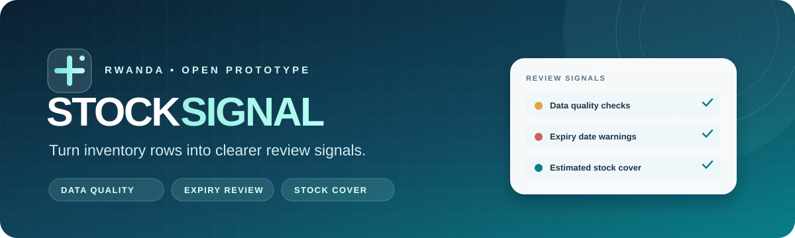

<div align="center">
  

  <h1>STOCKSIGNAL</h1>
  <p><strong>Turn inventory rows into clearer review signals.</strong></p>
  <p>A Rwanda-focused, human-in-the-loop prototype for reviewing medicine and health-commodity inventory data.</p>

  
  
  
  
</div>

---

## Why STOCKSIGNAL?

Inventory teams can only act on what records reveal. Missing values, stale updates, expiry dates, duplicate batch identifiers and uncertain stock-cover estimates can make an inventory export difficult to review.

**STOCKSIGNAL is a transparent review workspace.** It reads a structured CSV and surfaces rule-based findings for an authorised person to investigate. The snapshot comparison also shows how two exports differ at batch-record level. This is an early prototype for demonstrations and structured feedback, not a replacement for an electronic logistics management information system (eLMIS).

## What the prototype does

| Capability | What can be reviewed | Current implementation boundary |
|---|---|---|
| Data-quality checks | Missing fields, invalid numbers/dates, negative values, stale or future-dated updates | Visible rule-based checks; human verification required |
| Expiry review | Expired batches and batches inside a configurable warning window | An expiry flag is not a dispensing or disposal instruction |
| Duplicate detection | Repeated facility + product + batch keys | Ambiguous records are flagged rather than silently counted as separate trusted batches |
| Stock-cover screening | Estimated days of stock compared with lead time plus a configurable buffer | A simple screening estimate, not a validated forecast or reorder recommendation |
| Inventory snapshot comparison | Added, absent, changed, unchanged, duplicate and unmatchable batch identities across two CSV exports | Read-only, per-session comparison; no persistent audit database or automatic synchronisation |
| Downloadable evidence | Row-level, product-level, snapshot change reports and a comparison receipt | CSV exports for review; a receipt is not a tamper-proof audit log |
| Voice observation workflow | Record an audio memo, enter/verify a transcript and prepare a structured draft | No automatic speech recognition; text extraction is rule-based |
| Shelf-location map | Manually assign source rows to cells on a demonstration shelf grid | Session-only manual mapping; not connected to RFID, IoT or sensors |
| District coordination board | Prepare non-binding offers and expressions of interest | Session-only draft workflow; no clinical equivalence check, reservation, transfer or transport booking |
| Field work kit | Export source data and draft workflow records as a ZIP for spreadsheet review | Not a standalone offline app and has no automatic multi-user sync |

The calculations and rules are visible in [`stocksignal.py`](stocksignal.py), snapshot comparisons in [`stocksignal_snapshots.py`](stocksignal_snapshots.py), workflow prototypes in [`stocksignal_workflows.py`](stocksignal_workflows.py), and the interactive interface in [`app.py`](app.py). The calculations are deliberately explainable rather than presented as AI or a predictive model.

## Open the demonstration

**Official hosted demonstration:** [https://stocksignal-rwanda-regis.streamlit.app](https://stocksignal-rwanda-regis.streamlit.app)

Use synthetic demonstration data for a public presentation. The app is configured from this repository's `main` branch and `app.py` entry point. After a change is merged into `main`, Streamlit Community Cloud should deploy the updated code; confirm the deployment has completed before presenting.

## Run locally

### 1. Get the project

```bash
git clone https://github.com/ebanatrm100/stocksignal-rwanda.git
cd stocksignal-rwanda
```

### 2. Install dependencies

**Windows PowerShell**

```powershell
py -m venv .venv
.\.venv\Scripts\python.exe -m pip install --upgrade pip
.\.venv\Scripts\python.exe -m pip install -r requirements-dev.txt
```

**macOS / Linux**

```bash
python3 -m venv .venv
.venv/bin/python -m pip install --upgrade pip
.venv/bin/python -m pip install -r requirements-dev.txt
```

### 3. Run the app and tests

**Windows PowerShell**

```powershell
.\.venv\Scripts\python.exe -m streamlit run app.py
.\.venv\Scripts\python.exe -m pytest -q
```

**macOS / Linux**

```bash
.venv/bin/python -m streamlit run app.py
.venv/bin/python -m pytest -q
```

The local address (`http://localhost:8501`) is accessible only from the computer running the app. Use the hosted URL when presenting from another device.

## Snapshot comparison demonstration

The section **06 / Inventory change intelligence** compares two authorised CSV exports using the identity key `facility_code + product_code + batch_number`.

1. Upload `sample_snapshot_previous.csv` as **Previous inventory export**.
2. Upload `sample_snapshot_latest.csv` as **Latest inventory export**.
3. Review the summary and the row-level change report.
4. Download the change report and comparison receipt if you need presentation evidence.

The supplied records are fabricated. Expected demonstration summary: 1 added record, 1 record not present in the latest export, 3 changed records, 6 unchanged records, 1 ambiguous duplicate key and 0 rows with missing identity.

“Not present in latest” means only that the identity is absent from the newer file; it does not explain why. Duplicate keys are not automatically matched. The receipt records the comparison run and file names, but it is not a persistent database, cryptographic proof or tamper-proof audit log.

## CSV format

The inventory files use these exact required column names:

```text
facility_code
product_code
product_name
batch_number
quantity_on_hand
average_monthly_consumption
lead_time_days
expiry_date
last_stock_update
```

Dates should use `YYYY-MM-DD` where possible. Quantity and consumption must use compatible units. See [`data_dictionary.md`](data_dictionary.md) for field definitions and assumptions.

## How stock-cover screening works

\[
\text{Estimated days of stock} = \frac{\text{eligible stock quantity}}{\text{average monthly consumption} / 30.4375}
\]

The result is compared with recorded lead time plus the configurable review buffer. A result at or below that threshold is labelled for **human review**. It is not a reorder recommendation.

Expired batches, batches with missing expiry dates, duplicate batch keys, missing identity fields, invalid quantities and negative quantities are excluded from eligible stock quantity. The estimate does not model pending orders, seasonality, reservations, allocations, losses, demand spikes, supplier uncertainty, clinical criticality or local policy.

## Tests and continuous integration

Run the full suite with:

```bash
python -m pytest -q
```

Install development dependencies with `python -m pip install -r requirements-dev.txt`. The GitHub Actions workflow at [`.github/workflows/tests.yml`](.github/workflows/tests.yml) runs the tests on pushes and pull requests using Python 3.11 and 3.12.

The manual test plan is in [`test_cases.md`](test_cases.md). The competition walkthrough is in [`COMPETITION_DEMO_GUIDE.md`](COMPETITION_DEMO_GUIDE.md).

## Competition-ready intelligence tools

- **Field completeness profile:** reports missing/blank counts and completeness percentages for required CSV fields without inventing an opaque overall score.
- **What-if scenario simulator:** shows how user-entered consumption and lead-time assumptions change a simple stock-cover calculation; it is not a forecast or procurement recommendation.
- **GS1 barcode text capture:** parses selected GS1 AIs (01, 10, 17 and 21) from compatible scanner text or human-readable input into a draft for manual verification. It does not decode camera images or verify package authenticity.
- **Snapshot file fingerprints:** adds SHA-256 digests to comparison receipts to help identify exact uploaded file bytes. This is not a signed or tamper-proof audit trail.

These tools are transparent prototype helpers. Use only synthetic or approved data, and have authorised reviewers verify every parsed or calculated result.

## Roadmap

- Gather feedback from authorised pharmacy and supply-chain reviewers using synthetic or approved de-identified examples.
- Validate the rules against independently reviewed test cases and measure false positives and missed issues.
- Evaluate value alongside existing eLMIS processes before proposing interoperability.
- Design secure identity, role-based access, persistent audit history, retention and governance before any real-data pilot.
- Evaluate speech recognition and offline synchronisation only after language, privacy, network and conflict-handling requirements are defined.

These are future tasks, not claims of completed validation or integration.

## Safety and responsible use

> **Prototype only. Human review is required.**

- Do not upload patient information, credentials, confidential facility records or real inventory data to this public demonstration.
- Do not use output as an instruction to order, transfer, quarantine, dispense or discard stock.
- An authorised person must verify source records and follow approved procedures.
- Do not treat the estimate as a validated forecast or evidence of improved medicine availability.
- The project does not replace eLMIS, supply-chain policy or professional judgement.

See [`SECURITY.md`](SECURITY.md) before reporting an issue. The code is available under the [MIT License](LICENSE).

---

<div align="center">
  <strong>STOCKSIGNAL</strong><br />
  <sub>Clearer review signals. Human decisions stay with authorised people.</sub>
</div>
